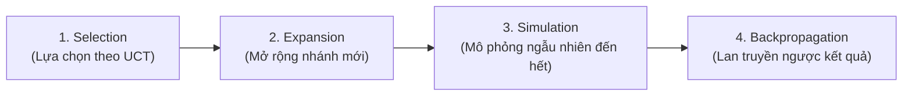

# Chương 8: Tìm Kiếm Cây Monte Carlo (Monte Carlo Tree Search - MCTS)
*Nguyên tác: Chapter 8: Monte Carlo Tree Search*
*Notebook gốc:* [ch08MonteCarloTreeSearch.ipynb](file:///d:/AlphaGoSimplified/ch08MonteCarloTreeSearch.ipynb)

---

## 1. Tư Duy Đột Phá Của MCTS

Nếu không thể viết một hàm đánh giá thế cờ heuristic bằng tay (như trong cờ vây), làm thế nào để biết một thế cờ hiện tại là tốt hay xấu?

> **Ý tưởng Monte Carlo**: Hãy để hai bên chơi ngẫu nhiên hàng nghìn ván cờ mô phỏng (*Rollout / Simulation*) bắt đầu từ trạng thái hiện tại đó cho đến khi kết thúc ván.
> Nếu từ trạng thái $S$, sau 1,000 ván mô phỏng ngẫu nhiên, Người 1 thắng tới 950 ván $\rightarrow$ Trạng thái $S$ chắc chắn là một thế cờ cực kỳ có lợi cho Người 1!

Phương pháp này hoàn toàn không đòi hỏi kiến thức chuyên môn (*Domain Knowledge*) về trò chơi!

---

## 2. Bốn Giai Đoạn Cốt Lõi Của Thuật Toán MCTS

MCTS lặp lại 4 bước sau trong suốt số lượt mô phỏng quy định (`num_rollouts`):



### 1. Selection (Lựa chọn)
Đi từ node gốc xuống các node con theo công thức **UCT (Upper Confidence Bounds for Trees)**:
$$\text{UCT}_i = \frac{w_i}{n_i} + c \sqrt{\frac{\ln N}{n_i}}$$
Trong đó:
- $\frac{w_i}{n_i}$: Giá trị khai thác (*Exploitation*) — tỷ lệ thắng trung bình của nước đi $i$.
- $c \sqrt{\frac{\ln N}{n_i}}$: Giá trị khám phá (*Exploration*) — khuyến khích thử các nước đi ít được ghé thăm.
- $c$: Hệ số nhiệt độ / hằng số khám phá (thường chọn $c = 1.4 \approx \sqrt{2}$).

### 2. Expansion (Mở rộng)
Nếu node được chọn chưa phải là trạng thái kết thúc ván, tạo thêm một node con ứng với một nước đi chưa được thử.

### 3. Simulation (Mô phỏng / Rollout)
Từ node mới, cho hai bên đánh ngẫu nhiên (`random rollout`) thần tốc cho tới khi có kết quả thắng/thua/hòa ($+1, -1, 0$).

### 4. Backpropagation (Lan truyền ngược)
Cập nhật ngược kết quả từ lá về gốc: tăng số lượt thăm $N \leftarrow N + 1$ và số trận thắng $W \leftarrow W + 1$ cho các node trên đường đi.

---

## 3. Cài Đặt Mã Nguồn Python

Toàn bộ thuật toán được đóng gói trong `utils/ch08util.py`:

```python
from math import sqrt, log
from copy import deepcopy
import random

def select(env, counts, wins, losses, temperature=1.4):
    # Ưu tiên các nước đi chưa từng được thử
    for k in env.validinputs:
        if counts[k] == 0:
            return k
            
    N = sum(counts.values())
    scores = {}
    for k in env.validinputs:
        vi = (wins.get(k, 0) - losses.get(k, 0)) / counts[k]
        exploration = temperature * sqrt(log(N) / counts[k])
        scores[k] = vi + exploration
        
    return max(scores, key=scores.get)

def expand(env, move):
    env_copy = deepcopy(env)
    _, reward, done, _ = env_copy.step(move)
    return env_copy, done, reward

def simulate(env_copy, done, reward):
    if done:
        return reward
    while True:
        move = env_copy.sample()
        _, reward, done, _ = env_copy.step(move)
        if done:
            return reward

def backpropagate(env, move, reward, counts, wins, losses):
    counts[move] = counts.get(move, 0) + 1
    if (reward == 1 and env.turn == 1) or (reward == -1 and env.turn == 2):
        wins[move] = wins.get(move, 0) + 1
    if (reward == -1 and env.turn == 1) or (reward == 1 and env.turn == 2):
        losses[move] = losses.get(move, 0) + 1
```

---

## 4. Ứng Dụng Đa Trò Chơi & Kết Quả
Hàm `mcts()` của chương này là một hàm **tổng quát (Generic Algorithm)**, áp dụng được cho cả 3 trò chơi:
1. **Coin Game**: Giải quyết hoàn hảo sau 1,000 lần rollout.
2. **Tic Tac Toe**: Hòa tuyệt đối trước MiniMax hoàn hảo.
3. **Connect Four**: Thắng áp đảo đối thủ nhìn trước 2 bước và đối thủ ngẫu nhiên.

> **Gợi ý lịch sử**: MCTS chính là khung xương điều khiển trung tâm của AlphaGo và AlphaZero! Tuy nhiên, việc mô phỏng ngẫu nhiên thuần túy vẫn còn chậm và thiếu trực giác. Trong Phần II và III tiếp theo, chúng ta sẽ đưa **Mạng nơ-ron học sâu (Deep Neural Networks)** vào để thay thế hoặc định hướng cho quá trình Selection và Simulation này!
